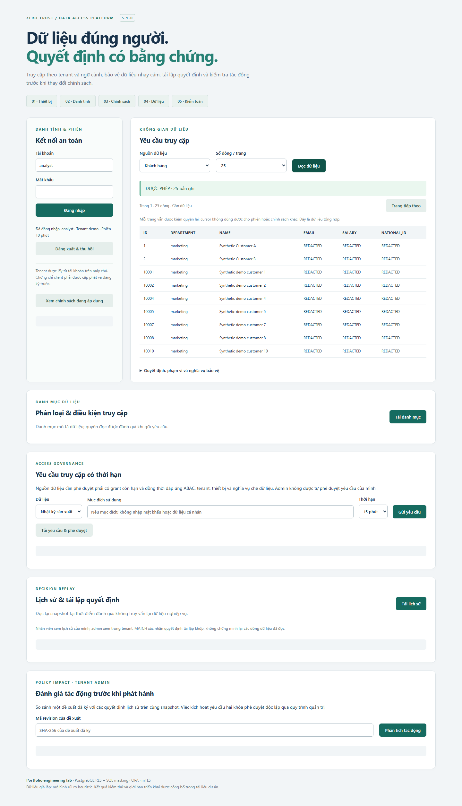
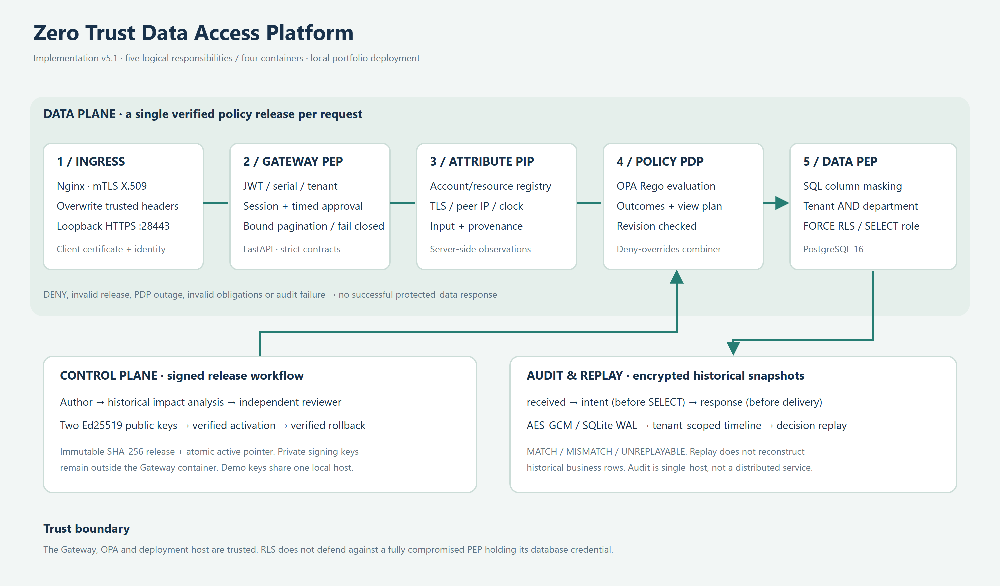

# Zero Trust Data Gateway

A multi-tenant data gateway that checks who is asking, which device they are using, and what data they can read. Built with FastAPI, Open Policy Agent, PostgreSQL and an Nginx mTLS ingress.

The interesting part is what happens around an access decision: keeping the decision and its SQL obligations on the same policy revision, recording enough context to replay it, and checking the impact of a policy change before activating it.



## What it does

- **Tenant and department isolation.** Tenant identity comes from the account registry and is bound to the token. SQL predicates and restrictive PostgreSQL RLS enforce the boundary, including for tenant admins.
- **Column masking in SQL.** Analyst requests return `REDACTED` for email, salary and national ID. Raw values for those columns do not enter the application response.
- **One policy revision per request.** A single OPA evaluation returns rule outcomes and a candidate view plan. The gateway validates the envelope before running a data query.
- **Signed policy releases.** Two distinct Ed25519 keys approve a content-addressed release. Activation uses an expected revision; rollback is verified in the same way.
- **Decision replay and impact analysis.** Encrypted historical snapshots let an auditor replay a decision or compare it with a proposed policy without querying business data again.
- **Revocable sessions and durable audit.** PostgreSQL stores active sessions; SQLite WAL stores encrypted audit snapshots. An audit failure withholds a successful protected-data response.

## A short walkthrough

An analyst in the demo tenant reads customer data. The gateway checks the client certificate and session, evaluates policy, then returns only marketing rows with PII masked. A beta tenant admin can read beta data but cannot switch tenant through a request header.

Next, a policy author proposes masking PII for admins too. A tenant admin runs impact analysis against recorded decisions, sees the changed masks, and a second signing key approves the release. After activation, new requests use the new masks. The previous release can be restored through a verified rollback.

If OPA is unavailable, the gateway returns `503` before the protected SELECT. After logout, replaying the token returns `401`.

## Architecture



Four containers implement five logical responsibilities: ingress, gateway enforcement, attribute resolution, policy evaluation and data enforcement. These are the project's responsibility boundaries, rather than a prescribed five-layer NIST model.

See [architecture and threat model](docs/portfolio-architecture.md) for the trust assumptions, transaction-local RLS context, signed release protocol and audit failure behavior.

## Run locally

Requires Python 3.12 and Docker with Compose. Start from the repository root:

```bash
python -m venv .venv
# Linux / macOS
source .venv/bin/activate
# Windows PowerShell: .\.venv\Scripts\Activate.ps1
python -m pip install -r requirements-lock.txt
python -m scripts.portfolio init
python -m scripts.portfolio doctor
python -m scripts.portfolio up
python -m scripts.seed_portfolio --rows 1000
```

Open **https://127.0.0.1:28443**. Generated account passwords are in `.gateway/credentials.json`. To use an enrolled browser, run `python -m scripts.export_device` and follow the [certificate and demo runbook](docs/portfolio-demo.md). The generated CA is for local development.

`init` refuses to overwrite an existing runtime. `python -m scripts.portfolio down` stops this deployment and preserves its named volumes. Database and OPA ports are not published on the host.

All business data is synthetic. The seed creates 1,000 customers per tenant, plus three original fixture rows. Repeating the same batch does not duplicate rows. Reads are capped at 100 rows per request.

## Tests and evidence

For the Python suite, install the locked dependencies and put OPA 1.4.2 on PATH, or set `OPA_BIN` to its executable:

```bash
python -m pytest -q
node tests/ui/gateway_session.cjs
```

For live deployment checks:

```bash
python -m scripts.validate_portfolio
python -m scripts.benchmark_portfolio
```

The live validation script temporarily changes the active policy and stops OPA in the dedicated demo deployment, restoring both afterward. Run it on the lab deployment.

Browser tests require Node.js and Playwright:

```bash
npm install --no-save playwright@1.62.1
npx playwright install chromium
node tests/ui/portfolio_live.cjs
```

Recorded on **23 October 2026**: 235 Python tests, 32 live checks, 6 browser checks and 4 delayed-response UI checks passed. These are historical results, not a claim that CI has just run. [Results and methodology](docs/portfolio-results.md) link to machine-readable evidence and the benchmark samples. The original verification receipt describes the pre-publication source tree; this repository was subsequently curated for publication.

The [GitHub Actions workflow](.github/workflows/verify.yml) runs the checks against a fresh deployment. Benchmark results are local, closed-loop measurements with audit enabled; they are not a production capacity estimate.

## Repository layout

```text
app/          Gateway, attribute provider, OPA client and decision combiner
policies/     Rego interpreter and policy catalogue
data/         Synthetic research fixtures
scripts/      Bootstrap, migrations, seed and validation commands
tests/        Unit, integration, policy, failure and browser checks
ui/           Gateway interface and optional research lab
docs/         Architecture, runbook, results and upgrade notes
evidence/     Recorded JSON/XML results, samples and screenshots
```

The optional research lab compares RBAC, static ABAC and context-aware ABAC. Its fixtures and interpreter tests are retained alongside the gateway.

## Trade-offs and unfinished work

The gateway and deployment host are trusted. RLS does not stop a compromised gateway holding a database credential from choosing another context. Client keys are files, not TPM-backed identities. Risk scoring is a small demo heuristic, not device telemetry.

Audit is single-host SQLite. Shared session revocation was checked using two independent store instances; multi-gateway failover has not been demonstrated. Replay reproduces access decisions, not historical database rows. The two demo signing keys are generated on one host and do not establish organizational separation of duties.

OIDC, a Trino adapter, time-limited access approvals and distributed audit remain future work. The application release format is JSON with signatures, not OPA's native bundle format.

## Documentation

- [Architecture and security boundaries](docs/portfolio-architecture.md)
- [Demo and operations](docs/portfolio-demo.md)
- [Recorded test results and benchmarks](docs/portfolio-results.md)
- [v4 to v5 upgrade report, Vietnamese](docs/upgrade-v4-v5.md)
- [Security reporting](SECURITY.md)
