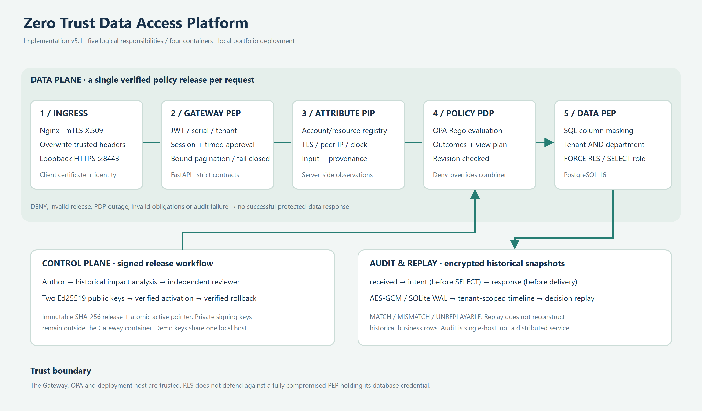

# Kiến trúc v5.1 và mô hình đe dọa

Bản vector: [architecture.svg](images/architecture.svg).

## 1. Ranh giới tin cậy

Client chỉ kết nối HTTPS tới Nginx trên loopback cổng 28443. PostgreSQL, OPA và Gateway không có host port. Network backend được đặt internal=true. Nginx ghi đè header xác minh thiết bị, serial và IP peer; Gateway kiểm shared proxy secret trước xử lý đường bảo vệ. Client thiếu chứng chỉ có thể mở trang/đăng nhập nhưng không được đọc dữ liệu.

Tenant là thuộc tính độc lập với department. Registry buộc khai báo tenant_id rõ ràng; giá trị mặc định trong Subject chỉ phục vụ lab nghiên cứu cũ, không được dùng để ngầm gán tenant cho tài khoản Gateway. JWT có tenant_id, auth_version và serial; đổi tenant của tài khoản làm token đang có mất hiệu lực. Tenant admin không có quyền chuyển tenant qua header/query.

Năm tầng dưới đây là phân chia trách nhiệm của dự án, không phải kiến trúc năm tầng được NIST quy định:

1. **Ingress:** Nginx, TLS, client X.509, header overwrite, giới hạn body/login.
2. **Gateway PEP:** token/phiên/tenant, input strict, định danh request, chặn lỗi.
3. **PIP:** registry account/resource và quan sát TLS/IP/clock hiện tại. Risk 10/50 là heuristic, không phải MDM hay telemetry bên ngoài.
4. **PDP:** OPA chạy interpreter Rego, một evaluation đọc một input release bất biến; Python combiner kiểm outcomes và deny-overrides.
5. **Data PEP:** allowlist view plan, SQL masking, predicate tenant và PostgreSQL RLS transaction-local.

## 2. Quyết định và obligations cùng revision

Release gồm policy catalogue, view profile và engine fingerprint. Hai chữ ký Ed25519 xác thực cùng canonical payload. File có tên theo SHA-256; active.json chỉ là con trỏ thay thế nguyên tử. Gateway đọc, xác thực release cho mỗi request, truyền snapshot đó vào OPA. Không cache quyết định ALLOW.

OPA endpoint `gateway/evaluation` trả một envelope gồm revision, engine_revision, outcomes và candidate plan. Candidate plan tồn tại không có nghĩa được phép đọc: chỉ khi envelope hợp lệ và combiner trả ALLOW mới gọi Database.query. Mismatch resource/tenant/revision, bất kỳ thay đổi nào so với mask, columns hoặc limit đã ký, hay scope sai đều bị từ chối.

Engine fingerprint gắn interpreter Rego, combiner, validator và adapter liên quan. OPA nạp deployment fingerprint từ file cấu hình cùng source. Khi đổi interpreter, phải triển khai lại và phát hành lại policy; replay snapshot dùng engine không còn tương thích trả UNREPLAYABLE. Đây là kiểm soát trong một trusted deployment, không phải remote attestation chống một OPA đã bị chiếm quyền.

Activation dùng khóa file độc quyền và expected revision để ngăn lost update từ hai người vận hành. Khi tiến trình activation chết giữa chừng, có thể còn lock file; operator xác minh không còn publisher rồi mới dọn lock. Không tự bỏ khóa theo timeout và kích hoạt mù. Rollback áp dụng cùng kiểm chữ ký, không tự fallback sang policy không hợp lệ.

## 3. Cô lập dữ liệu

Runtime role gateway_reader chỉ được SELECT ba bảng nghiệp vụ. RLS department là permissive policy; tenant gate được khai báo AS RESTRICTIVE, vì vậy tenant là điều kiện AND ngay cả khi có thêm một permissive department policy trong tương lai. Tất cả ba bảng ENABLE và FORCE RLS.

Trước SELECT, adapter đặt `gateway.tenant_id`, `gateway.scope`, `gateway.department` bằng set_config(..., true) trong transaction. Thiếu tenant/context thì không có dòng. Kết thúc transaction làm context hết hiệu lực trên connection dùng lại. SQL còn có predicate tenant như một lớp bổ sung, không dựa riêng vào WHERE của ứng dụng.

Mask được thực thi bằng literal REDACTED trong SELECT; dữ liệu cột nhạy cảm của analyst không đi vào Python. Tên bảng/cột lấy từ allowlist; không có endpoint SQL tùy ý, SQL regex rewriter hay quyền export hàng loạt. Mỗi lần đọc tối đa 100 dòng theo signed view profile. Phân trang keyset dùng `id > last_id`, lấy thêm một dòng để xác định trang kế tiếp. Cursor có HMAC và TTL 10 phút, ràng buộc toàn bộ subject, session jti, resource, policy revision và page size; thay đổi một thành phần làm cursor mất hiệu lực. Mỗi trang đánh giá lại policy và grant; không giữ snapshot PostgreSQL qua nhiều request. Customer seed hiện có hai tenant; financial/production giữ tập fixture nhỏ của tenant demo.

**Giới hạn:** Gateway giữ credential có thể đặt context. Gateway bị chiếm quyền có thể tự đặt tenant/scope khác; RLS không phải biện pháp chống lại chính trusted PEP bị chiếm quyền. Muốn ranh giới mạnh hơn phải cân nhắc role/database riêng cho tenant và identity delegation.

## 4. Kiểm toán, replay và impact

Audit ghi ba thời điểm: received khi request bắt đầu, intent sau quyết định và trước SELECT, response trước khi middleware trả body. Request ID liên kết các event; UNIQUE(request_id, phase) ngăn ghi trùng im lặng. Nếu response audit lỗi sau SELECT, dữ liệu không được gửi về nhưng db_queried=true phải được báo trung thực. Nếu tiến trình chết trước response event, lịch sử có intent chưa hoàn tất; không được suy ra request đã trả thành công.

Metadata chỉ lưu route template, quyết định, số dòng và nghĩa vụ; không lưu token, password hoặc data rows. Subject identifier được hash nhưng không coi đó là ẩn danh chống đoán. Snapshot thuộc tính, thời điểm, provenance, release và kết quả được mã hóa AES-GCM với nonce ngẫu nhiên, AAD ràng buộc request/tenant/actor/metadata. Mã hóa không thay thế hạn chế quyền truy cập file/khóa.

Nhân viên chỉ xem replay của mình; admin chỉ trong tenant. Thiếu lịch sử hoặc không đủ quyền trả UNREPLAYABLE giống nhau. Replay dùng input và giờ đã ghi, không đọc clock/registry hiện tại; không chứng minh lại mọi dòng trong một database lịch sử chưa được snapshot.

Impact chỉ nhận một proposal có chữ ký từ kho release cục bộ, được tenant admin yêu cầu. Nó so sánh trên tập hữu hạn lịch sử tenant: DENY→ALLOW, ALLOW→DENY, mask, scope, tenant, columns, limit và reason. Không dùng tập mẫu này để chứng minh mọi đầu vào tương lai. Một candidate có quyền rộng hơn vẫn cần review; hệ thống chưa có quy trình tự động từ chối mọi mở rộng quyền theo risk budget.

SQLite WAL với synchronous=FULL phù hợp một Gateway host; chưa có audit outbox phân tán, retention scheduler, KMS rotation hoặc SIEM export. Backup toàn runtime mã hóa AES-GCM, khóa tách riêng, dùng pg_dump custom và trạng thái SQLite sau khi tạm dừng ingress/Gateway. Restore vào thư mục mới, kiểm SHA-256 từng file và khôi phục thử PostgreSQL cô lập không mạng. Chi tiết và giới hạn trong [operations](operations.md). Phải sao lưu khóa mã hóa riêng; mất khóa làm lịch sử không giải mã được. Hash/fingerprint không được gọi là cơ chế chống sửa bởi administrator toàn quyền.

## 5. Phiên dùng chung và hiệu năng

PostgreSQL session store dùng role gateway_session riêng, chỉ SELECT/INSERT/DELETE bảng gateway_auth.sessions. Role này không đọc customer_data. Store chỉ giữ hash jti và thời điểm hết hạn. Mọi authentication kiểm phiên trực tiếp, không dùng cache ALLOW; pool tối đa 5 connection mỗi store.

Logout thu hồi dòng phiên. Kiểm chứng hiện tại dùng hai store instance độc lập cùng PostgreSQL; chưa triển khai hai Gateway replica với load balancer. Request đã vượt authentication và đang chạy không bị hủy hồi tố. PostgreSQL hoặc pool timeout làm request lỗi, không fallback dùng phiên cũ.

Benchmark là closed-loop local HTTPS, CA verification, 100 dòng/response, audit ON, concurrency 1/5/10, 100 mẫu đo mỗi mức và 10 warmup riêng mỗi mức. Số liệu không so trực tiếp với v4 vì đã thêm session DB, chữ ký, ghi audit bền vững và tăng dữ liệu. CPU/IO có thể chia sẻ với các dự án Docker khác trên máy.

## 6. Quy trình cấp quyền có thời hạn

Catalog trả metadata tài nguyên và cờ cần phê duyệt cho danh tính đã xác minh. Mặc định Compose yêu cầu grant cho `production`; resource khác vẫn tuân theo ABAC. Nhân viên tạo yêu cầu có mục đích 10–500 ký tự và thời hạn 60–3.600 giây. Admin cùng tenant được duyệt, không được tự duyệt; pending hết hạn sau 24 giờ. Thời hạn cấp quyền bắt đầu lúc duyệt, không bắt đầu lúc gửi.

Trước protected SELECT, Gateway yêu cầu đồng thời OPA ALLOW, view plan hợp lệ và grant còn hiệu lực nếu resource yêu cầu. Grant gắn với id/tenant/role/department/clearance; thay đổi thuộc tính làm grant cũ mất tác dụng. Revoke hoặc expiry được đọc lại ở request kế tiếp, không hủy query đang chạy. Một analyst được duyệt production vẫn bị ABAC từ chối nếu phòng ban không hợp lệ.

Access store dùng SQLite WAL cục bộ, lưu mục đích bằng văn bản rõ trong vùng trạng thái riêng. Không ghi mục đích/token/business rows vào audit metadata công khai. Giao dịch access store và audit store độc lập: lỗi response audit có thể trả 503 sau khi approval/revoke đã commit; client phải tải lại trạng thái, không suy ra mutation đã rollback. Đây chưa phải workflow đa node hay transactional outbox.

## 7. Threat model và việc chưa triển khai

| Tình huống | Kiểm soát hiện có | Giới hạn |
|---|---|---|
| Client giả header | Nginx overwrite, private proxy secret | Proxy/root host bị chiếm quyền ngoài ranh giới |
| Token bị sao chép | Serial binding + shared allowlist + TTL | Private key file bị đánh cắp vẫn nguy hiểm; chưa TPM |
| Admin đọc tenant khác | Token tenant, mandatory predicate, restrictive RLS | Không chống trusted Gateway bị chiếm quyền |
| Policy bị thay file | Hai chữ ký khác public key, content digest | Hai private key demo cùng máy; chưa HSM/CI approvals thật |
| PDP outage | 503, fail-closed, không SELECT | Mất khả dụng là đánh đổi có chủ ý |
| Audit disk full | Chặn trả dữ liệu, event failure rõ | Chưa có remote durable outbox/retention tự động |
| Quyền bị thay đổi | Registry đọc mỗi request, version/tenant check | Không phải continuous mid-query revocation |
| Phụ thuộc có CVE | Khóa phiên bản + pip-audit và rerun tests | Không thay image/OS scan, pentest hay chứng nhận |

OIDC/PKCE/JWKS rotation, Trino SQL authorization, OpenTelemetry collector, multi-host audit và HA vẫn là nhánh phát triển tiếp. Không có tính năng giả lập gắn nhãn đã hoàn thành.

## 8. Nguồn thiết kế

- [PostgreSQL 16 RLS, restrictive/permissive policy và bypass model](https://www.postgresql.org/docs/16/ddl-rowsecurity.html)
- [OPA Data API và query/evaluation](https://www.openpolicyagent.org/docs/rest-api)
- [OPA native bundles để đối chiếu; workflow JSON hiện tại của dự án là cơ chế riêng](https://www.openpolicyagent.org/docs/management-bundles)
- [NIST SP 800-207](https://csrc.nist.gov/pubs/sp/800/207/final)
- [FastAPI release notes](https://fastapi.tiangolo.com/release-notes/)
- [Cryptography release notes](https://cryptography.io/en/latest/changelog/)
