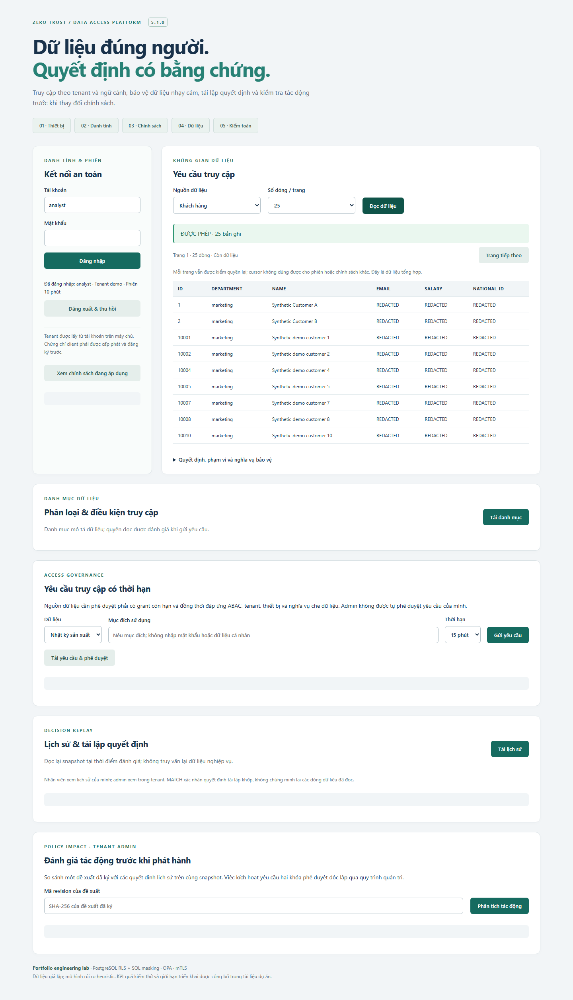
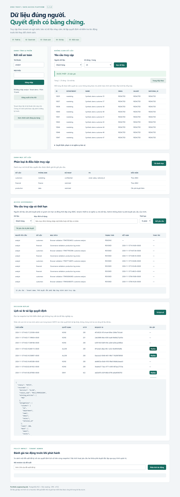
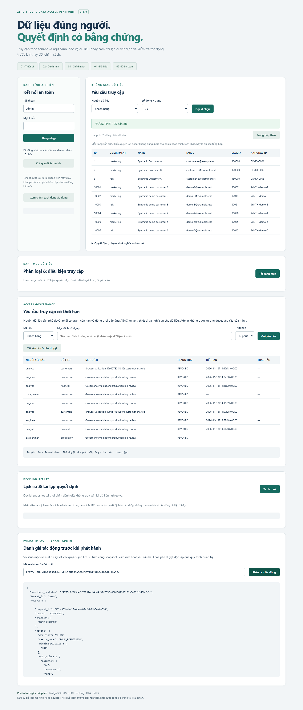

# BÁO CÁO NÂNG CẤP ZERO TRUST ABAC TỪ v4.0 LÊN v5.0

**Ngày lập báo cáo:** 30/10/2026  
**Phiên bản trước:** Zero Trust ABAC Data Gateway v4.0  
**Phiên bản nâng cấp:** Zero Trust Data Access Platform v5.0  
**Nguồn kiểm chứng:** mã nguồn, tài liệu kiến trúc và bộ minh chứng thực thi ngày 23/10/2026. Báo cáo này tổng hợp kết quả đã lưu, không đại diện cho một lượt chạy lại ngày 30/10/2026.

## 1. Mục tiêu nâng cấp

Phiên bản v4.0 tập trung mô phỏng và thực nghiệm quyết định truy cập theo thuộc tính, ngữ cảnh trong kiến trúc Zero Trust. Hệ thống đã có mTLS, JWT ràng buộc chứng chỉ, kiểm tra phiên, OPA, SQL masking và PostgreSQL Row-Level Security.

Phiên bản v5.0 mở rộng bài toán sang quản trị truy cập dữ liệu cho nhiều đơn vị: xác định tenant bắt buộc, kiểm soát vòng đời chính sách, lưu bằng chứng quyết định, tái lập lịch sử và phân tích tác động trước khi phát hành. Hướng nâng cấp phục vụ portfolio Data Platform/Security Engineering thông qua một luồng nghiệp vụ có thể chạy và kiểm chứng.

## 2. Bảng đối chiếu tổng thể

| Nội dung | v4.0 | v5.0 |
|---|---|---|
| Phạm vi dữ liệu | Phân quyền theo vai trò, phòng ban và ngữ cảnh | Bổ sung tenant độc lập với department |
| Quyền admin | Scope all trong tập dữ liệu của nguyên mẫu | Scope all vẫn bị giới hạn trong tenant của tài khoản |
| Ràng buộc token | Serial chứng chỉ, phiên và auth_version | Bổ sung tenant_id, kiểm thay đổi tenant khi xác thực |
| Quyết định và nghĩa vụ | Đánh giá quyền và lấy view plan bằng hai lời gọi OPA | Một evaluation trả outcomes và candidate plan cùng revision |
| Phát hành policy | Catalogue đọc từ tệp cấu hình | Release định danh SHA-256, hai chữ ký Ed25519, activation và rollback |
| Audit | Chủ yếu ghi logger | SQLite WAL bền vững, snapshot mã hóa AES-GCM, kiểm soát quyền đọc |
| Replay | Chưa có cơ chế tái lập quyết định lịch sử hoàn chỉnh | Replay cùng snapshot đã ghi, trả MATCH/MISMATCH/UNREPLAYABLE |
| Impact analysis | Chưa có workflow chuyên biệt | So sánh policy đề xuất với kết quả lịch sử trên cùng input |
| Phiên đăng nhập | SQLite cục bộ | PostgreSQL session store với role riêng và bounded connection pool |
| Dữ liệu customer | 3 bản ghi fixture | 2.003 bản ghi, gồm 2.000 dòng synthetic bổ sung cho hai tenant |
| Giao diện | Đăng nhập, đọc dữ liệu và xem bằng chứng cơ bản | Bổ sung active policy, lịch sử, replay và impact analysis |
| Vận hành | Các script dựng và kiểm tra nguyên mẫu | Bootstrap/doctor/migrate, verification gate, CI workflow và sealed package |
| Kiểm thử pytest | Snapshot lịch sử 198 ca đạt | Snapshot v5: 235 ca đạt |

## 3. Các nâng cấp chi tiết

### 3.1. Cô lập tenant ở nhiều điểm thực thi

Tenant đại diện cho đơn vị sở hữu dữ liệu, còn department đại diện cho phòng ban bên trong đơn vị. Hai thuộc tính được tách để tránh việc cùng thuộc marketing trở thành căn cứ truy cập dữ liệu của một tổ chức khác.

Registry tài khoản Gateway buộc khai báo tenant rõ ràng. Token chứa tenant_id và được đối chiếu lại với registry; token hiện hành mất hiệu lực nếu tài khoản được chuyển sang tenant khác. Header hoặc query do client gửi không được dùng để tự chọn tenant.

Adapter SQL thêm điều kiện tenant vào truy vấn. PostgreSQL bổ sung restrictive RLS policy để tenant được kết hợp bằng AND với các policy cấp quyền theo phòng ban. Context tenant/scope/department được đặt transaction-local, tránh giữ phạm vi của request trước trên connection dùng lại. Thiếu tenant/context không trả dòng dữ liệu.

Kết quả thực nghiệm xác nhận admin tenant beta không nhìn thấy dữ liệu tenant demo, header giả không đổi được tenant, và scope all thiếu tenant vẫn nhận không dòng. RLS không được coi là biện pháp chống một Gateway đã bị chiếm quyền và giữ credential có thể tự đặt context.

### 3.2. Đồng nhất quyết định và kế hoạch thực thi

Ở v4.0, hai lời gọi OPA tách biệt chưa chứng minh sự nhất quán revision nếu bổ sung cập nhật policy trực tiếp. v5.0 xử lý yêu cầu này bằng một evaluation trả cả outcomes và candidate view plan từ cùng input release.

Gateway kiểm revision, engine revision, tenant, resource, nghĩa vụ che dữ liệu và phạm vi phòng ban trước khi thực thi. Candidate plan chỉ được dùng khi kết quả kết hợp chính sách là ALLOW; sự tồn tại của plan tự nó không cấp quyền.

Ca kiểm thử đồng thời thay đổi active release trong lúc nhiều request đang chạy xác nhận revision của decision và obligations khớp nhau, đồng thời trạng thái masking phù hợp với release được áp dụng.

### 3.3. Quản lý vòng đời chính sách có chữ ký

Release mới chứa catalogue, view profile và fingerprint interpreter. Payload chuẩn hóa được định danh bằng SHA-256 và ký bằng Ed25519. Kích hoạt yêu cầu hai public key khác nhau; đặt hai tên cho cùng một key không đáp ứng điều kiện phê duyệt.

Workflow gồm tạo proposal, ký tác giả, chạy impact analysis, ký bằng khóa reviewer, kích hoạt với expected revision và rollback nếu cần. Activation dùng khóa độc quyền và thay thế active pointer nguyên tử để tránh ghi đè thay đổi của người vận hành khác. Policy bị sửa nội dung hoặc thiếu chữ ký không được dùng để cấp quyền.

Kiểm thử đã phát hiện lỗi Windows/Docker giữ handle đọc khiến atomic replacement trả WinError 5. Bản sửa retry có giới hạn cho cùng thao tác nguyên tử; lỗi kéo dài giữ pointer cũ và không chuyển sang ghi đè từng phần.

Đây là giao thức release JSON của ứng dụng, chưa phải OPA native bundle hoặc dịch vụ GitOps approval. Hai khóa demo được sinh trên cùng máy; cơ chế mật mã chưa thay thế việc tách hai người phê duyệt trong tổ chức.

### 3.4. Kiểm toán bền vững và mã hóa snapshot

v5.0 lưu audit bằng SQLite WAL với synchronous=FULL. Các sự kiện received, intent và response liên kết bằng request ID. Intent được ghi trước SELECT; response được ghi trước khi middleware gửi body thành công.

Snapshot phục vụ replay lưu thuộc tính, provenance, thời điểm đánh giá, release và kết quả. AES-GCM mã hóa snapshot với nonce ngẫu nhiên; AAD ràng buộc bản mã với request, tenant, actor và metadata để phát hiện việc thay thế giữa các sự kiện.

Audit không lưu password, bearer token hoặc business data rows. Metadata có quyết định, số dòng và obligations. Nhân viên chỉ xem lịch sử của mình; admin chỉ xem trong tenant.

Lỗi ghi audit làm Gateway giữ lại phản hồi dữ liệu. Nếu SELECT đã chạy trước khi lỗi ghi response xảy ra, db_queried phải được ghi nhận trung thực là true. Backup bằng SQLite backup API đã được kiểm đọc lại và đối chiếu event. Audit vẫn là mô hình đơn host, chưa có outbox phân tán hoặc retention scheduler.

### 3.5. Decision Replay

Replay dùng đúng snapshot thuộc tính và thời điểm đánh giá đã lưu, thay vì lấy registry hoặc clock hiện tại. Kết quả gồm MATCH khi tái lập khớp, MISMATCH khi khác và UNREPLAYABLE khi không có lịch sử được phép đọc hoặc interpreter/PDP không tương thích, không sẵn sàng.

Thực nghiệm xác nhận thay đổi registry hiện tại không làm replay dùng nhầm thuộc tính mới, và replay không gọi SELECT dữ liệu nghiệp vụ. Chức năng này tái lập quyết định truy cập; hệ thống chưa có snapshot database để khôi phục chính xác mọi dòng đã được người dùng đọc trong quá khứ.

### 3.6. Policy Impact Analysis

Tenant admin có thể chọn proposal đã ký để so sánh trên lịch sử của tenant. Policy cũ và policy đề xuất được đánh giá bằng cùng input snapshot, giúp xác định thay đổi do chính sách thay vì thay đổi dữ liệu đầu vào.

Các thay đổi được nhận diện gồm DENY→ALLOW, ALLOW→DENY, mask, row scope, tenant, cột dữ liệu, giới hạn dòng và reason. Kịch bản live đã phát hiện MASK_CHANGED khi đề xuất bổ sung che PII cho admin; unit tests kiểm cả mở rộng và thu hẹp quyền.

Phân tích sử dụng tập lịch sử hữu hạn và có giới hạn số mẫu. Nó hỗ trợ review, chưa chứng minh chính sách đúng cho mọi đầu vào tương lai hoặc tự động từ chối mọi trường hợp mở rộng quyền.

### 3.7. Phiên đăng nhập dùng chung và connection pool

Phiên được chuyển từ SQLite cục bộ sang PostgreSQL với role gateway_session riêng. Role này chỉ có quyền SELECT/INSERT/DELETE bảng phiên, không có quyền đọc customer_data. Store giữ hash jti và thời điểm hết hạn.

Mỗi lần xác thực vẫn kiểm trạng thái phiên trực tiếp, không cache kết quả active. Bounded connection pool giảm việc tạo kết nối mới cho từng request. Logout xóa phiên và token sao chép bị từ chối ở request kế tiếp.

Minh chứng hiện có xác nhận hai store instance độc lập cùng quan sát thu hồi. Chưa có phép thử end-to-end qua hai Gateway replica; request đã vượt qua xác thực và đang thực thi không bị hủy hồi tố.

### 3.8. Dữ liệu tổng hợp và chất lượng dữ liệu

Batch seed tạo 1.000 customer cho mỗi tenant demo/beta bằng quy tắc xác định, sử dụng upsert để chạy lại không nhân đôi. Manifest lưu hợp đồng dữ liệu, cột PII, SHA-256 SQL, số dòng, kiểm tra chất lượng và fingerprint đối chiếu.

| Tenant | Marketing | Risk | Tổng customer |
|---|---:|---:|---:|
| demo | 669 | 334 | 1.003 |
| beta | 667 | 333 | 1.000 |
| Tổng | 1.336 | 667 | 2.003 |

Ba fixture ban đầu được bảo tồn. Financial và production vẫn dùng tập fixture nhỏ; nâng cấp này chưa bao gồm connector ingest nguồn doanh nghiệp thực. API đọc tối đa 100 dòng mỗi request, chưa có pagination dữ liệu nghiệp vụ.

### 3.9. Giao diện và trải nghiệm demo

Giao diện v5 hiển thị tenant phiên đăng nhập, policy đang active, bảng dữ liệu đã được bảo vệ, lịch sử audit, replay và vùng nhập revision để phân tích tác động. Bố cục hỗ trợ màn hình di động.

Bổ sung kiểm soát phản hồi đến trễ để dữ liệu hoặc lịch sử không xuất hiện lại sau logout; kết quả request đọc cũ không được ghi đè request mới. Các ca Node VM kiểm hành vi này dùng mã UI thật; kiểm thử Chromium xác nhận luồng trình duyệt và chụp ảnh minh chứng.

### 3.10. Vận hành, dependency và bàn giao

Bổ sung lệnh init, doctor, up, down, status và migrate. Runtime mới dùng deployment abac-portfolio để tách dữ liệu/chứng chỉ khỏi bản học thuật. Gateway chạy non-root, filesystem gốc read-only; DB/OPA không mở host port và backend network được đặt internal.

Dependency được cập nhật, khóa phiên bản và tách runtime với lab/dev. Scanner trước nâng cấp báo 126 advisory entries trên 8 package; đây là kết quả tra cứu cảnh báo, không phải 126 lần khai thác đã tái hiện. Snapshot sau nâng cấp báo 0 lỗ hổng đã biết trên 64 package được scan. Phạm vi này không thay thế quét đầy đủ OS image, Nginx/OPA binaries hoặc pentest ứng dụng.

Verification gate chạy lint, pytest, UI tests, Docker, live security/recovery, browser, benchmark và dependency audit. Receipt lưu fingerprint mã nguồn/cấu hình trước và sau thực thi. Đóng gói từ chối nếu source đã đổi sau gate; ZIP có manifest SHA-256, kiểm CRC và kiểm bí mật runtime.

CI workflow đã được cung cấp. Minh chứng hiện tại là thực thi local, chưa phải một lượt GitHub Actions đã chạy trên remote.

## 4. Kết quả kiểm thử và đo lường

### 4.1. Kiểm thử chức năng và an ninh

| Nhóm | Kết quả snapshot v5 |
|---|---|
| Pytest | 235/235 đạt; không failure/error/skip |
| Kiểm tra Docker/HTTPS/mTLS/RLS/recovery | 32/32 đạt |
| Kiểm tra Chromium thật | 6/6 đạt |
| UI xử lý response đến trễ | 4/4 đạt |
| Dependency audit Python | 0 lỗ hổng đã biết được scanner trả về |

So với snapshot v4 có 198 pytest đạt, v5 có thêm 37 ca theo tổng số. Số lượng này không phải thước đo trực tiếp cho mức an toàn hay tỷ lệ bao phủ code. Thời gian và môi trường hai phiên bản khác nhau nên không dùng thời gian chạy test để kết luận tốc độ hệ thống.

Các bất biến nổi bật đã được kiểm: không đọc chéo tenant; không thực thi plan sai revision/tenant/scope; không kích hoạt release chỉ có một khóa; policy bị sửa bị chặn; PDP outage trả 503 trước SELECT; token sau logout bị từ chối; audit lỗi giữ lại dữ liệu; context RLS hết hiệu lực sau transaction.

### 4.2. Hiệu năng

Số liệu chính xác theo từng concurrency, thời gian JUnit và ngày chạy nằm trong [báo cáo kết quả hiện hành](portfolio-results.md). Dữ liệu gốc ở [benchmark summary](../evidence/benchmark.json) và [raw CSV](../evidence/benchmark-samples.csv).

Phép đo v5 gồm 300 mẫu đo và 30 warmup tách riêng, concurrency 1/5/10, HTTPS kiểm CA/hostname, mTLS, cap 100 dòng, RLS/masking, shared session và audit bật. P50/P95 dùng nearest rank; RPS tính trên elapsed của từng mức concurrency.

Không so trực tiếp các chỉ số với v4 vì dữ liệu, dependency, session lookup và nghĩa vụ audit đã thay đổi. Connection pool và giảm dependency là các tối ưu đã triển khai; chưa có thiết kế thí nghiệm đủ kiểm soát để quy mọi chênh lệch benchmark cho riêng một tối ưu.

## 5. Tính năng kế thừa và phần chưa triển khai

mTLS, JWT ngắn hạn, certificate serial binding, policy ABAC, deny-overrides, SQL masking, PostgreSQL FORCE RLS và OPA outage fail-closed là nền tảng kế thừa từ v4. Không tính lại toàn bộ các năng lực đó thành tính năng mới của v5; điểm mới nằm ở tenant, revision consistency, governance, audit/replay và khả năng vận hành đã bổ sung.

Các hạng mục chưa triển khai đầy đủ gồm OIDC/PKCE/JWKS, Trino adapter, access request có approval/expiry, OTel collector, distributed audit, end-to-end nhiều Gateway replica, disaster recovery toàn nền tảng và TPM/MDM. v5 là bản portfolio có kiểm chứng; chưa có căn cứ gọi đây là hệ thống production-ready hoặc đã được chứng nhận tuân thủ.

## 6. Đánh giá giá trị của nâng cấp

Nâng cấp chuyển trọng tâm từ trả lời “request có được phép không” sang quản trị được cả quá trình thay đổi và chứng minh quyết định: ai thuộc tenant nào, release nào được áp dụng, dữ liệu phải bị hạn chế ra sao, vì sao quyền thay đổi và lịch sử có tái lập được hay không.

Giá trị portfolio nằm ở việc kết nối các ràng buộc an ninh với dữ liệu và vận hành: restrictive tenant RLS, plan cùng revision, kiểm toán trước phản hồi, replay có snapshot, proposal có chữ ký và đo lường có raw evidence. Các giới hạn được công bố để người xem đánh giá đúng phạm vi thực hiện.

## 7. Tài liệu và minh chứng đối chiếu

- [README và cách khởi chạy](../README.md).
- [Kiến trúc và threat model](portfolio-architecture.md).
- [Demo và vận hành](portfolio-demo.md).
- [Kết quả thực nghiệm](portfolio-results.md).
- [Receipt gắn fingerprint code](../evidence/verification-receipt.json).
- [JUnit XML](../evidence/pytest.xml).
- [Live security/recovery](../evidence/live-validation.json).
- [Browser checks](../evidence/browser.json).
- [Seed manifest](../evidence/seed-manifest.json).
- [Dependency audit](../evidence/dependency-audit.json).

### Ảnh giao diện thực tế

*Hình 1. Giao diện v5 với dữ liệu customer đã áp dụng masking cho analyst.*

*Hình 2. Tái lập quyết định từ snapshot kiểm toán.*

*Hình 3. Tenant admin phân tích tác động của đề xuất thay đổi masking.*
